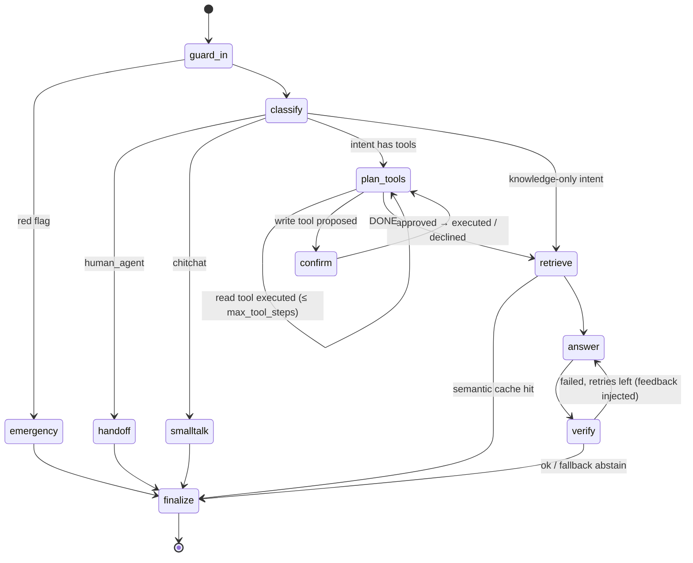

# Agent Graph (LangGraph)

## Nodes

| Node | Model? | Reads | Writes | Notes |
|---|---|---|---|---|
| `guard_in` | no | raw message | `query` (redacted), `pii_found`, `injection_score`, `read_only`, `triage` + turn reset | Deterministic, < 2 ms |
| `emergency` | no | `triage` | `final`, P1 handoff ticket | Never touches the LLM, cache or tools |
| `classify` | fast tier | `query`, last turns, carried `entities` | `intent`, `confidence`, `entities`, `search_query`, `needs_live_data` | Schema-forced `IntentResult`. `needs_live_data` separates "my record / an action" from "how does it work" (INC-004); carried ids count only for true follow-ups (INC-008) |
| `plan_tools` | smart tier | `intent`, `entities`, tools allowed for intent, results so far | `tool_results` or `pending_action` | Least-privilege tool list; read-only if injection suspected |
| `confirm` | no | `pending_action` | executes or records decline | `interrupt()` → resumed with `Command(resume={...})` |
| `retrieve` | no | `search_query`, `intent` | `evidence` or cached `draft` | Cache only when no tool data was used; **pinned governing chunks** per intent (e.g. medical-advice boundary, INC-006) |
| `answer` | smart tier | assembled context | `draft` (`AnswerOut`) | Skips the LLM and abstains if there is no evidence and no tool data |
| `verify` | no | `draft`, context | `verify` | Up to `max_verify_retries` regenerations with problem list as feedback |
| `handoff` | no | conversation | ticket id | Context packet for the human agent |
| `smalltalk` | fast tier | — | `final` | — |
| `finalize` | no | everything | `final`, `messages`, `summary`, cache put, metrics | Adds stale-policy warning |

## State discipline
- Conversation-level keys persist via the checkpointer: `messages`, `entities`, `previous_intent`, `summary`.
- Turn-level keys are **reset in `guard_in`** (`TURN_RESET`), so a tool result from a previous turn
  can never be cited in this turn (prevents "context bleed").
- Messages store the **redacted** text only; raw PII never reaches the checkpoint store.

## Bounded loops
- Tool loop: `max_tool_steps` (default 4) + each tool at most once per turn with the same args.
- Verify loop: `max_verify_retries` (default 1).
- Worst case LLM calls per turn: 1 classify + 4 plan + 2 answer = 7; typical 2-3.
