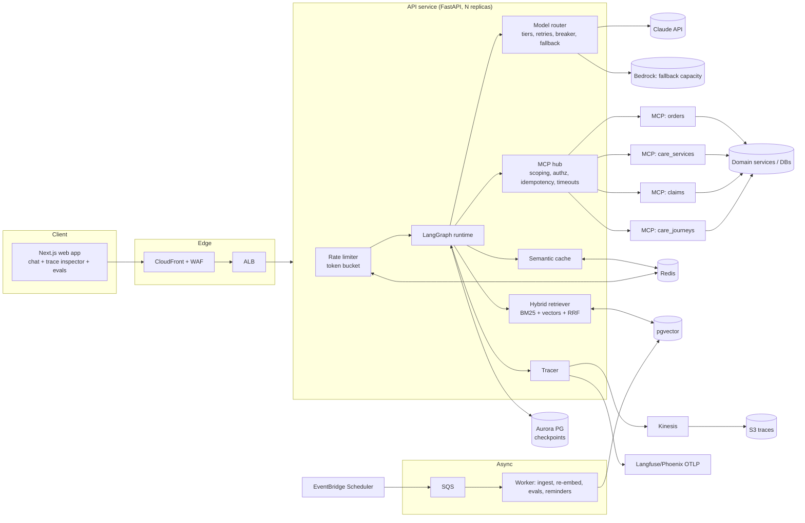

# Architecture Overview

## Component diagram

## Request lifecycle (one turn)
1. **Edge**: WAF (bot/abuse rules) → ALB → API replica (stateless).
2. **Auth + rate limit**: user id from session/JWT; per-user token bucket (Redis Lua).
3. **Graph run** (`thread_id` → checkpoint loaded from Postgres):
   `guard_in → classify → [plan_tools ⇄ execute | confirm] → retrieve → answer → verify → finalize`
4. **Streaming**: every node completion is pushed to the client as an SSE event (UI shows progress).
5. **Persistence**: new checkpoint written; trace flushed async; metrics incremented.
6. **HITL**: a write tool pauses the graph with `interrupt()`; the client gets a confirm card; the
   next request resumes the same checkpoint on **any** replica.

## Why this shape
- **Stateless API + durable checkpoints** → horizontal scale and zero-downtime deploys.
- **Tools behind MCP servers** → each domain team owns its server, its scaling, its SLO.
- **One choke point per external dependency** (router for models, hub for tools) → retries,
  timeouts, breakers and tracing are written once.
- **Deterministic guards around a probabilistic core** → safety properties hold even if the model,
  the provider, or the prompt regresses.

See: [agent-graph.md](agent-graph.md) · [rag-pipeline.md](rag-pipeline.md) ·
[mcp-layer.md](mcp-layer.md) · [context-engineering.md](context-engineering.md) ·
[safety-and-guardrails.md](safety-and-guardrails.md) · [data-model.md](data-model.md) ·
[api-reference.md](api-reference.md)
