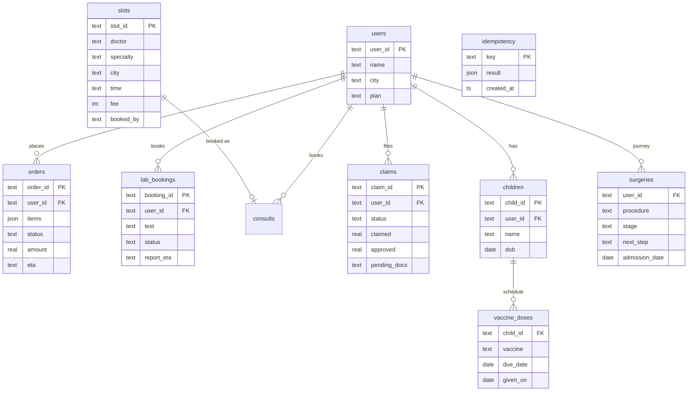

# Data Model

## Domain (behind MCP servers) — `sahay/mcp_servers/store.py`

## Agent-side stores
| Store | Key | Content | Retention |
|---|---|---|---|
| Checkpoints | `thread_id` + checkpoint id | Graph state (redacted messages, entities, summary) | 30 days |
| Traces | `trace_id` | Spans with attributes (tokens, cost, hits, tool args) | 7 days hot, 90 days cold (S3) |
| Feedback | `trace_id` | thumbs up/down + comment | 1 year (eval mining) |
| Handoffs | `ticket_id` | Context packet, priority, status | Per CS policy |
| Semantic cache | (intent, prompt_version, kb_version) + vector | Non-personal answers | TTL 1 h |

## Seed users (dev)
| User | Persona | Demo flows |
|---|---|---|
| U1001 Ananya (Bangalore, Care Plus) | Parent of Aarav (≈2.5 months) | order ORD-1042 out for delivery, ORD-1043 cancellable, LAB-7781, claim CLM-55020 partial, vaccine due in 3 days |
| U1002 Rahul (Mumbai) | Cataract surgery journey | ORD-2077 prescription hold, CLM-55012 documents pending, LAB-7790 ready |
| U1003 Fatima (Hyderabad, Care Plus) | Parent of Zoya (overdue MMR) | CLM-55031 under review, LAB-7795 culture processing |
