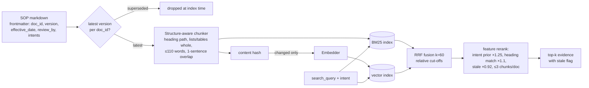

# RAG Pipeline

## Design choices
| Choice | Why | Failure it prevents |
|---|---|---|
| Heading-path in chunk text | Cheapest context injection: "Refund > Lab tests" disambiguates "5-7 days" | Right number, wrong product |
| Lists/tables never split | Timelines and document lists live in lists | Half a document checklist |
| Version gate at index time | Only latest `version` per `doc_id` is indexed | v1 policy (10-14 days) retrieved instead of v2 (5-7 days) |
| `review_by` stale flag | Soft penalty + explicit warning to user | Silently serving expired policy |
| Content-hash incremental embed | Only changed chunks are re-embedded | Re-embed cost; mixed embedding spaces |
| Embedder id recorded | Changing model forces full re-embed | "Stale embeddings": old vectors from a different model |
| BM25 + dense + RRF | Ids/drug names need lexical; paraphrase needs dense | "my kid's jab" vs "HbA1c" |
| Relative cut-offs before RRF | RRF rewards appearing in both lists, even low ranks | Noise chunk beats the right chunk (see incident INC-001) |
| Diversity cap 3/doc | Context budget is shared | 5 chunks of one doc crowd out the second relevant doc |
| Min score → abstain | No evidence → no LLM call → no hallucination | Confident answer from irrelevant text |

## Top-k reasoning
`top_k=5` with a 6k-token budget: typical chunk ≈ 90-150 tokens, so 5 chunks ≈ 600 tokens — retrieval
is not the budget pressure; tool results and history are. We keep k small because each extra
irrelevant chunk measurably increases the chance the model cites the wrong section (precision
matters more than recall once recall@5 ≥ 0.95 on the golden set).

## Production path 🧭
- Embeddings: Voyage/Cohere (multilingual for Hinglish), stored in pgvector with HNSW (`m=16, ef_construction=64`).
- Reranker: cross-encoder on top-20 behind a flag; adopt only if eval shows ≥ +3 pts answer accuracy for ≤ +150 ms p95.
- Ingestion via SQS worker on S3 upload events; `kb_version` = hash of indexed chunk hashes, part of the cache key.
