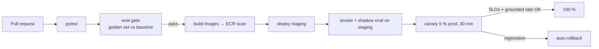

# Deployment on AWS

## Topology
- **Region** ap-south-1, 3 AZs. VPC with public subnets (ALB, NAT) and private subnets (everything else).
- **ECS Fargate services**: `api` (min 6), `mcp-orders`, `mcp-care-services`, `mcp-claims`, `mcp-care-journeys` (min 2 each), `worker` (min 1).
- **Data**: Aurora PostgreSQL 16 (writer + reader, pgvector), ElastiCache Redis 7 (primary + replica), S3 (KB source, trace lake), SQS (ingest, evals, reminders).
- **Edge**: CloudFront → WAF → ALB. Next.js static assets on CloudFront/S3; SSR on ECS or Vercel.
- **Secrets**: Secrets Manager (`ANTHROPIC_API_KEY`, DB creds). IAM task roles; Bedrock via IAM.
- IaC in [`infra/terraform`](../../infra/terraform).

## CI/CD

## Prompt / model changes are deployments
- `prompt_version` is a config value; a change runs the full eval gate and goes through canary.
- Canary compares grounded rate, abstain rate, tool error rate and 👎 rate vs control; rollback on regression.
- KB changes (PR to `data/kb`) run retrieval evals; `kb_version` changes invalidate the semantic cache automatically.
