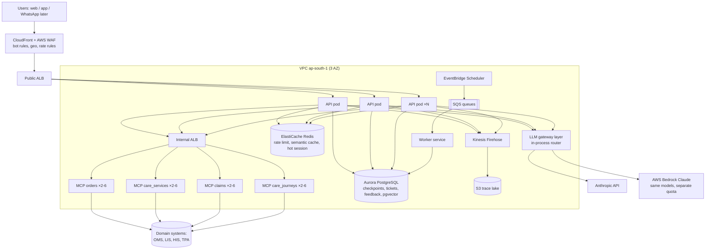

# High-Level Design

## Request path and latency budget (tool turn, p50)
| Step | Budget |
|---|---|
| Edge + ALB + auth + rate limit | 15 ms |
| Load checkpoint (Aurora, by PK) | 5 ms |
| guard_in | 2 ms |
| classify (fast model) | 350 ms |
| plan (fast-path: 0 ms; LLM: 600 ms) | 0-600 ms |
| MCP tool call | 60 ms |
| retrieve (embed 40 ms + search 3 ms) | 45 ms |
| answer (smart model, ~220 output tokens) | 1,200 ms |
| verify + finalize + checkpoint write | 15 ms |
| **Total** | **~1.7 s (fast-path) / ~2.3 s (LLM plan)**; p95 target ≤ 4 s |

## Key design decisions (details in [../05-decisions](../05-decisions/))
1. Stateless API, state in Postgres checkpoints (ADR-0003).
2. MCP servers as separately-scaled services per domain (ADR-0002).
3. Two LLM providers behind one router, model tiers per node (ADR-0005).
4. Deterministic safety outside the model (ADR-0006).
5. Eval gate in CI for every prompt/model/KB change (ADR-0008).
